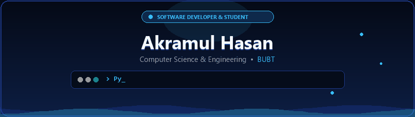

<div align="center">



<br/>

[](https://github.com/akramulhasanemon?tab=followers)
[](mailto:akramulhasan180@gmail.com)

</div>

---

###  About Me

```yaml
name: Akramul Hasan
institution: Bangladesh University of Business and Technology (BUBT)
major: Computer Science & Engineering (B.Sc. in CSE)
passions: [Modern Desktop Systems, Machine Learning, Clean Architecture]
current_focus: Building intelligent, offline-first student & academic tools
motto: "Simplicity and precision build enduring software."
```

- 🎓 **Undergraduate Student** in CSE at **BUBT**, passionate about engineering efficient real-world software.
- 💻 Specialized in **Python (PyWebView, CustomTkinter, Desktop Architecture)** and modern web technologies.
- 🛠️ Creator of **[EduTrack](https://github.com/akramulhasanemon/edutrack)** — an academic trajectory intelligence & CGPA forecasting engine.
- 🎯 Always excited about high-DPI glassmorphism interfaces, local ML models, and clean architecture.

---

### 🚀  Interactive Tech Stack & Ecosystem

<div align="center">

<a href="#">
  
</a>

</div>

---

### ⭐ Featured Innovations

| Project | Description | Tech Stack | Status |
| :--- | :--- | :--- | :---: |
| 🎓 **[EduTrack](https://github.com/akramulhasanemon/edutrack)** | Academic trajectory forecasting & student intelligence workspace with offline ML advisor and high-DPI bioluminescent glass UI. | `Python` `PyWebView` `SQLite` `Scikit-Learn` | 🟢 Active |
| 👥 **[CRConnect-App](https://github.com/akramulhasanemon/CRConnect-App)** | Centralized batch coordination and classroom representative management portal. | `Web Technologies` `UI/UX` | 🟢 Active |
| 📌 **[GitHub Issues Tracker](https://github.com/akramulhasanemon/github-issues-tracker)** | Dynamic issue tracking and productivity dashboard. | `JavaScript` `REST API` | 🟢 Active |

---

### 📊 Real-time Analytics & Activity

<div align="center">
  
  
</div>

<div align="center">
  
</div>

---

### 📈 Contribution Wave Graph

<div align="center">
  
</div>

---

<div align="center">
  <i>💡 "Simplicity is the soul of efficiency." — Let's connect and build something extraordinary!</i>
</div>
